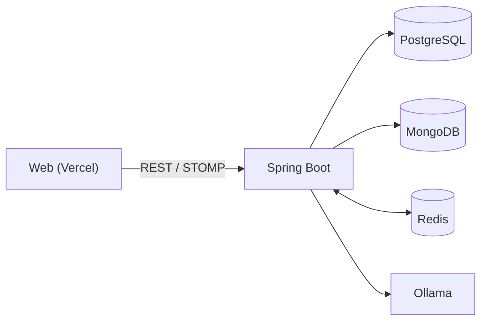

# Desserting

> **디저트와 소개팅이 만나, 디저팅이 되다.**
> 
> 디저트 취향으로 상대를 연결하고, 그 취향에 맞는 카페까지 제안하는 소셜 매칭 서비스

<p align="center">
  
</p>

2026 단디톤 · Team 원투쓰리

- 배포 주소: https://desserting-web.vercel.app
- 백엔드 저장소: https://github.com/Desserting/Desserting-was
- 프론트엔드 저장소: https://github.com/Desserting/Desserting-web

## 목차

1. [서비스 소개](#서비스-소개)
2. [핵심 기능](#핵심-기능)
3. [기술 스택](#기술-스택)
4. [실행 방법](#실행-방법)
5. [프로젝트 구조](#프로젝트-구조)
6. [아키텍처와 설계 결정](#아키텍처와-설계-결정)
7. [코드 작성 원칙](#코드-작성-원칙)
8. [컨벤션과 협업 방식](#컨벤션과-협업-방식)

## 서비스 소개

<p align="center">
  
</p>

Desserting은 **"좋아하는 디저트"라는 가벼운 공통점**으로 첫 대화를 엽니다.

1. **만나다**: 좋아하는 디저트를 고르면, 같은 취향 또는 다른 취향의 상대를 지역·거리 조건 안에서 추천받습니다.
2. **대화하다**: 마음에 드는 상대에게 하트 1개로 대화를 요청하고, 수락되면 바로 실시간 채팅을 시작합니다.
3. **가다**: 채팅 안에서 AI가 두 사람에게 어울리는 카페를 제안하고, 예약·주문까지 이어집니다.

> 아래는 아이디어를 발전시킨 네 가지 질문 **WHY LOCAL → WHY PEOPLE → WHY SERVICE → FOR WHOM**에 대한 우리의 답입니다.

### 1. WHY LOCAL? 왜 대구·경북인가

**대구·경북은 카페에 가는 것이 일상인 지역입니다.**

<p align="center">
  
</p>

- **이미 큰 카페 시장**: 커피음료점 **10,495곳**, 월 카드 결제액 약 **875억 원**(연 1조 원 규모)
- **전국보다 빠른 성장**: 전년 동월 대비 카드 결제액 증가율 대구 +15.2%, 경북 +17.4%로 전국 평균(+14.1%)을 웃돕니다.
- **사람이 모이는 카페 문화**: 2026 대구 음식산업박람회·커피&카페페스타에 3일간 약 **4만 1천 명**이 다녀갔습니다.


<p align="center">
  
</p>

한 매장이 아니라 **거리 전체가 목적지**가 됩니다. 포항 영일대, 경주 황리단길, 구미 금리단길, 대구 김광석길과 앞산 카페거리처럼 카페와 디저트를 즐기러 가는 거리가 대구 도심부터 경북 각 도시까지 이어져 있습니다.

카페와 사람은 이미 충분합니다. 비어 있는 것은 **둘을 만남으로 이어 줄 서비스**입니다.

### 2. WHY PEOPLE? 그 가치는 사람들에게 왜 필요한가

카페 거리에서 우리가 얻는 것은 커피 한 잔이 아니라, **좋아하는 것을 함께 즐길 사람과 편하게 마주 앉는 경험**입니다.

- 디저트는 2030의 일상이자 이야깃거리입니다. 주 3회 이상 디저트를 먹는 비율이 20대 54.2%, 30대 54.9%로, 두 명 중 한 명 이상이 디저트를 일상처럼 즐깁니다.[^1]
- 카페는 좋은 첫 만남 장소입니다. 카페에서 첫 만남을 가졌을 때 애프터 성사율은 51%로, 저녁 식사(39%)보다 12%p 높습니다.[^2]

그런데 카페에서 만나기까지의 과정은 순탄하지 않습니다.

1. 사진과 스펙 중심의 매칭에 피로감을 느낍니다.
2. 매칭이 되어도 할 말이 없어 대화가 끊깁니다.
3. 어느 카페로 갈지 정하는 일조차 부담이 됩니다.

**부담 없는 설렘**과 **같은 취향에서 오는 친밀감**은 대구·경북 사람에게만 필요한 것이 아닙니다. 사진·스펙 중심의 만남에 지친 누구에게나 필요하고, 그래서 지역을 넘어 전달할 수 있는 가치입니다. 강릉 안목해변, 서울 성수, 부산 전포동, 청주 수암골, 전주 한옥마을, 제주 애월처럼 카페 거리는 전국 곳곳에 있습니다.

### 3. WHY SERVICE? 경험이 만들어지는 원리를 서비스로

> **"디저트는 사람을 만나는 이유가 된다."**

지역의 카페·디저트 경험을 *장소*가 아니라 *만남의 계기*로 재해석했습니다. 지역의 모습을 그대로 옮기는 대신, 그 경험이 **만들어지는 원리**를 뽑아 서비스로 다시 설계했습니다.

| 카페 거리에서 경험이 만들어지는 원리 | 디저팅으로 재설계한 방식 |
| --- | --- |
| 같은 거리에 모인 사람은 **취향이 이미 겹친다** | **디저트 취향**으로 상대를 추천합니다. 같은 취향(공감)과 다른 취향(새로운 발견) 중 고를 수 있습니다. |
| **가까워서** 부담 없이 만난다 | **생활권·거리 반경** 안에서 실제로 만날 수 있는 사람만 추천합니다. |
| 장소가 **대화의 소재**가 된다 | 채팅 안에서 **AI가 어울리는 카페**와 메뉴를 제안하거나 직접 카페·시간을 제안할 수 있고, 예약·결제까지 이어집니다. |

기존에는 카페가 "만나서 가는 곳"이었다면, Desserting에서는 **디저트 취향이 먼저 만나고**, 카페는 그 취향을 이어가는 **다음 단계**가 됩니다.

### 4. FOR WHOM? 누구에게 가치가 있는가

#### To User

- 디저트라는 공통점으로 어색함 없이 대화를 시작합니다.
- 채팅부터 예약·방문까지 끊김 없이, 웨이팅 걱정 없이 이어집니다.
- 하루 무료 하트 5개 · 추가 하트 개당 200원 · 무제한 월 9,900원

#### To Store

- 입점비 0원으로 부담 없이 시작합니다. (월 2만 원 + 결제 수수료 7%)
- 새로운 고객이 들어오는 채널을 얻습니다.
- 선결제 시스템으로 노쇼가 줄어듭니다.

### 5. 비즈니스 모델

| 수익원 | 내용 | 상태 |
| --- | --- | --- |
| **하트(재화)** | 대화 요청에 쓰는 하트(요청 1회당 1개)를 수량별 상품으로 판매 | 화면 구현 완료 (현재 모의 결제) |
| **프리미엄 패스** | 월 단위 이용권. 프리미엄 회원은 하트 무제한 (혜택 목록은 서버에서 제공) | 화면 구현 완료 (현재 모의 결제) |
| **제휴 매장** | 제휴 카페 노출, 예약·주문 연계 수수료 월 20,000원 + 수수료 7% | 매장 목록·예약·주문 화면 구현 |

### 6. 전국 확장 가능성

취향이 겹치는 사람, 가까운 거리, 대화 소재가 되는 장소라는 원리는 대구에만 있는 것이 아닙니다. 이미 구미·경주·포항처럼 경북 각 도시에도 같은 구조의 카페 거리가 있고, 부산 서면·전주 한옥마을처럼 디저트 거리가 뚜렷한 지역이라면 그대로 적용할 수 있습니다.

[^1]: 픽플리, 2025-2026 디저트 소비자 경험 데이터 분석
[^2]: Bumble, 글로벌 데이팅 트렌드 분석 리포트(2024)

---

## 핵심 기능

### 만나다: 디저트 취향으로 만나요

> 사진과 스펙 대신, **좋아하는 디저트**로 상대를 찾아요.

<p align="center">
  
</p>

| 단계 | 동작 |
| --- | --- |
| **① 취향 선택** | 가입할 때 케이크·베이커리·구움과자·타르트&파이·빙수&아이스크림·커피·차&논커피·전통 디저트, **8개 카테고리 중 여러 개**를 고릅니다. |
| **② 랜덤 매칭** | 홈에서 **같은 취향**(입맛이 꼭 닮은 사람) 또는 **다른 취향**(새로운 맛을 알려줄 사람)을 고르고, 지역과 거리를 설정하면 조건에 맞는 후보를 랜덤으로 추천받습니다. |
| **③ 프로필 확인** | 상대의 닉네임·나이, 지역·거리, 좋아하는 디저트, 한 줄 소개를 보고 **좋아요**를 누르거나 **하트 1개**를 써서 대화를 요청합니다. |

### 대화하다: 대화를 읽고 카페를 제안하는 AI

> 두 사람의 대화를 읽고, 어울리는 **카페와 메뉴**를 골라 드려요.

<p align="center">
  
</p>

| 단계 | 동작 |
| --- | --- |
| **① 채팅 시작** | 대화 요청이 수락되면 채팅 목록에 대화방이 생기고, 바로 실시간 대화를 시작합니다. |
| **② AI 대화 분석** | 채팅 중 **카페 방문 제안하기**에서 **AI가 추천해 줘요**를 고르면, 서버가 대화 내용을 보고 두 사람 취향에 맞는 **제휴 카페와 메뉴**를 고릅니다. **직접 고를래요**를 선택해 매장과 날짜·시간을 직접 정해 보낼 수도 있습니다. |
| **③ 카페와 메뉴 제안** | 매장 이름·주소, 추천 메뉴, 추천 이유가 담긴 카드가 **"일시 미정"** 상태로 채팅방에 도착합니다. 카드를 본 뒤 **일정 제안하기**나 **카페 방문 예약하기**로 이어집니다. |

예를 들어 대화에서 "앞산 쪽에 아눅 앞산이라고 있던데"라는 말이 나오면, AI는 **아눅 앞산**을 골라 대표 메뉴인 **바스크 치즈케이크·피스타치오 크루키**와 함께 제안합니다.

- **왜 AI인가**: 처음 만난 두 사람에게 가장 어려운 질문인 "어디서 볼까?"를 대신 풀어, 대화에서 만남으로 넘어가는 순간을 쉽게 만듭니다. 인기순이 아니라 대화 맥락에 맞춰 고른다는 점이 지도·리뷰 앱과 다릅니다.
- **구현 방식**: 클라이언트는 추천을 요청(`POST /v1/chats/rooms/{roomId}/ai-recommendation`)만 하고, 추천 카드는 서버가 STOMP로 **양쪽 모두에게** 보냅니다. 두 사람이 같은 카드를 같은 시점에 보게 하기 위해서입니다.
- **안정성**: 응답의 `source`로 추천 엔진을 구분합니다(`OLLAMA_LOCAL_QWEN` / `SMART_KEYWORD_FALLBACK`). 로컬 AI가 느리거나 실패하면 키워드 기반 추천으로 대체됩니다. 로컬 모델 응답을 고려해 요청 대기 시간을 40초로 두고, 대기 중에는 시트를 닫지 못하게 해 카드가 갑자기 도착하는 혼란을 막았습니다.

### 가다: 지도에서 찾고, 예약·결제까지 한 번에

> 만날 카페를 **테마 거리 지도**에서 고르고, 예약과 주문까지 앱 안에서 끝내요.

<p align="center">
  
</p>

| 단계 | 동작 |
| --- | --- |
| **① 테마거리 선택** | 카페 지도에서 김광석 다시그리기길, 삼덕동 카페골목 같은 테마 거리를 고르면 지도가 그 거리로 이동하고, 거리 경계와 제휴매장 수를 보여줍니다. |
| **② 제휴매장 탐색** | 거리와 디저트 종류로 매장을 걸러 보고, 매장마다 거리, 대표 메뉴, **디저팅 회원 혜택**(예: 특정 메뉴 주문 시 디저트 증정)을 확인합니다. |
| **③ 날짜·시간 선택** | 달력에서 방문 날짜를 고르고, 예약 가능한 시간대 중 하나를 선택합니다. |
| **④ 메뉴 담기** | 디저트·음료·세트 탭에서 메뉴와 수량을 고르면 총 수량과 금액이 바로 계산됩니다. 품절 메뉴는 따로 표시됩니다. |
| **⑤ 예약 완료** | 매장, 예약 날짜, 시간을 확인하고, **예약/주문 내역**에서 다시 볼 수 있습니다. |

### 전체 기능

| 영역 | 설명 |
| --- | --- |
| 회원가입 | 이메일 가입 → 관심 디저트 선택 → 프로필 입력의 단계별 플로우 |
| 매칭 | 같은 취향 / 다른 취향 중 선택해 랜덤 후보 카드를 받고, 좋아요·대화 요청을 보냄 |
| 채팅 | 대화 요청 수락·거절, STOMP(WebSocket) 기반 실시간 채팅, AI 카페 추천 또는 직접 장소·일정 제안 |
| 카페 탐색 | NAVER 지도의 테마거리 위에서 매장을 탐색하고 메뉴 조회·주문·예약 |
| 제휴 매장 | 매장 목록과 내 위치 기준 거리 표시, 상세 정보 |
| 마이페이지 | 프로필 수정, 하트(재화) 구매, 프리미엄 패스, 주문 내역 |

---

## 기술 스택 (Tech Stack)

| 분류 | 기술 / 라이브러리 | 버전 |
| :--- | :--- | :--- |
| **Cloud Infra** | **GCP Compute Engine + Caddy** | Ubuntu 24.04 |
| **Language** | **Java** | 21 (LTS) |
| **Framework** | **Spring Boot** | 3.3.5 |
| **AI / LLM** | **Ollama (Qwen 2.5 3B)** | 3.1B 파라미터 |
| **RDB** | **PostgreSQL** | 16-alpine |
| **NoSQL** | **MongoDB** | 7.0 |
| **In-Memory** | **Redis** | 7.2-alpine |
| **Security** | **Spring Security + JJWT** | JJWT 0.12.6 |
| **API Docs** | **SpringDoc OpenAPI** | 2.6.0 |
| **Container** | **Docker & Docker Compose** | v29.9 / v5.7 |

---


## 실행 방법

필요한 것: JDK 21, Docker, Docker Compose

```bash
# 1. 환경 변수 준비 (필요하면 값 수정)
cp .env.example .env

# 2. 인프라 실행 (PostgreSQL, MongoDB, Redis, Ollama)
docker compose up -d postgres mongodb redis ollama

# 3. AI 모델 내려받기
docker exec desserting-ollama ollama pull qwen2.5:3b

# 4. 서버 실행
./gradlew bootRun
```

백엔드까지 Docker로 한 번에 실행하려면 `docker compose up -d --build`를 사용합니다.

실행 후 `http://localhost:8080/swagger-ui/index.html`에서 API 문서를 확인할 수 있습니다. `local` 프로필에서는 시작할 때 관리자 계정과 데모 데이터가 자동으로 생성됩니다.

---

## 프로젝트 구조

도메인별로 패키지를 나누고, 각 도메인 안에서 `controller` · `service` · `repository` · `entity` · `dto`로 계층을 구분합니다.

```text
src/main/java/com/desserting/backend
├── domain
│   ├── auth · user          # 인증, 프로필, 취향
│   ├── matching · heart     # 랜덤 매칭, 대화 요청, 하트·프리미엄
│   ├── chat · ai            # 실시간 채팅, AI 카페 추천
│   ├── store · theme        # 제휴 매장·메뉴, 테마거리
│   ├── reservation · order  # 예약, 주문·결제
│   └── admin · storeowner   # 관리자 콘솔, 점주 포털
└── global                   # 설정, 보안(JWT), 예외 처리, 공통 응답
```

그 밖에 `docs/`(API·연동 가이드), `scripts/`(더미 유저 생성), `Dockerfile`, `docker-compose.yml`이 있습니다.

---

## 아키텍처와 설계 결정



- **용도별 멀티 DB**: 유저·매장·예약처럼 정합성이 중요한 데이터는 PostgreSQL, 채팅 메시지는 MongoDB, 채팅 Pub/Sub은 Redis가 맡습니다.
- **실시간 채팅**: STOMP(WebSocket)로 주고받고, Redis Pub/Sub으로 메시지를 전달합니다. 예약 상태 변경도 같은 방식으로 점주 포털에 실시간으로 반영됩니다.
- **AI 추천 폴백**: 대화 내용을 로컬 LLM(Ollama)에 보내 카페와 메뉴를 추천받고, 모델이 실패하면 키워드 기반 추천으로 대체해 서비스가 끊기지 않게 했습니다.
- **동시성 제어**: 하트 차감, 예약 결제, 예약 슬롯처럼 동시 요청이 몰릴 수 있는 곳은 비관적 락과 `@Version` 낙관적 락으로 보호합니다.
- **인증·권한**: 무상태 JWT 인증이며, 권한은 `USER` · `STORE_OWNER` · `ADMIN` 세 가지입니다.

---

## 코드 작성 원칙

- 도메인 단위로 패키지를 나누고, 여러 도메인이 쓰는 코드만 `global`에 둡니다.
- 엔티티를 API에 직접 노출하지 않고 `dto`로 요청·응답을 분리합니다.
- 예외는 `CustomException`과 `ErrorCode`로 던지고, `GlobalExceptionHandler`가 공통 형식으로 응답합니다.
- 환경별 값과 비밀값은 코드에 넣지 않고 환경 변수로 받습니다.
- API를 만들거나 바꾸면 Swagger 명세와 테스트도 함께 갱신합니다.

---

## 컨벤션과 협업 방식

### 브랜치

| 브랜치 | 용도 |
| :--- | :--- |
| `main` | 시연·제출용 안정 버전 (PR로만 병합) |
| `feat/*` · `fix/*` · `docs/*` | 기능 개발, 버그 수정, 문서 수정 |

### 커밋 메시지

`type: 설명` 형식을 사용합니다. (`feat`, `fix`, `docs`, `refactor`, `test`, `chore`)

### 협업

- 프론트엔드([Desserting-web](https://github.com/Desserting/Desserting-web))와는 Swagger 명세와 `docs/`의 연동 가이드로 API 변경 사항을 공유합니다.
