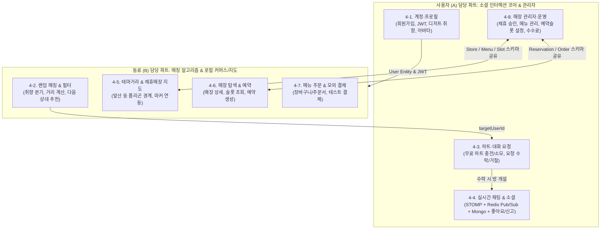

# 🍰 디저팅(Desserting) 백엔드 구현 종합 기획서 & 2인 협업 분업안

> **단디톤(Dandi-thon 2026) 백엔드 분업 구조 확정 및 계정/프로필 우선 개발 기획서**  
> 기준 기간: 2026.11.03 ~ 2026.11.10 (7일간 집중 개발)  
> 상태: 승인 대기 (RequestFeedback: true)

---

## 1. 계정/프로필 우선 개발 및 분업 적합성 분석

### 1.1. "계정/프로필부터 만들고 확장하는 것"의 타당성
- **결론: 매우 적절하며 반드시 선행되어야 하는 최선의 순서입니다.**
- **이유**:
  1. **모든 도메인의 Root Dependency**: 매칭(4-2), 하트/대화요청(4-3), 채팅(4-4), 매장 예약(4-6) 모두 `User` 엔티티와 `userId` 외래키를 참조합니다.
  2. **Security Context 확립**: Spring Security 6 및 Stateless JWT 토큰 발급, 인증 필터(`JwtAuthenticationFilter`), `@AuthenticationPrincipal` 주입 구조가 먼저 마련되어야 동료 개발자도 로그인한 유저 기반의 API를 개발할 수 있습니다.
  3. **프론트엔드 선행 작업 지원**: 프론트엔드가 로그인 후 토큰 저장(Zustand), 회원가입/프로필 폼 검증(Zod + RHF), Axios 인터셉터를 설정하려면 4-1이 가장 먼저 배포되어야 합니다.

---

### 1.2. 백엔드 2인 분업 구조 평가



#### ✅ 이 분업 구조의 강력한 장점
1. **높은 도메인 응집도**:
   - 사용자(A)는 **"소셜/유저 인터랙션 흐름(유저 -> 하트 -> 대화 요청 -> 실시간 채팅방)"** 전체를 맡아 라이프사이클이 끊기지 않고 자연스럽게 연결됩니다.
   - 요청 수락 시 채팅방 생성(`REQ-01` -> `CHT-01`)이 단일 담당자의 책임 안에서 처리되므로 의사소통 비용이 대폭 감소합니다.
2. **기술 스택의 명확한 역할 분담**:
   - 사용자(A): **Spring Security + JWT + STOMP WebSocket + Redis Pub/Sub + MongoDB** (실시간/보안 기술 스택 집중).
   - 동료(B): **PostgreSQL 공간 쿼리/반경 계산 + JPA Fetch Join + 지도/커머스 도메인** (데이터 조회/트랜잭션 집중).

#### ⚠️ 분업 시 반드시 주의해야 할 2가지 협업 접점 (해결책 포함)
1. **4-8(매장 관리자)과 4-5/4-6(매장 지도/예약) 간의 엔티티 스키마 충돌 방지**:
   - `Store`, `ThemeStreet`, `StoreMenu`, `Reservation` 엔티티는 A와 B 모두가 사용합니다.
   - **해결책**: Phase 1(공통 기반 환경 구축)에서 **엔티티 기본 스키마(JPA Entity)를 A와 B가 함께 합의하고 프로젝트에 미리 선언**해 둔 후 각자의 비즈니스 로직(A는 등록/수정/승인, B는 조회/예약/결제)을 작성합니다.
2. **4-2(랜덤 매칭)와 4-3(대화 요청)의 연동**:
   - B가 4-2를 통해 "상대방 User ID와 프로필 카드"를 프론트에 응답하면, 프론트는 그 `targetUserId`를 가지고 A가 만든 4-3의 `POST /api/v1/matches/requests`를 호출합니다.
   - 따라서 B에게 필요한 것은 오직 A가 정의한 `User` 엔티티와 식별자(`userId`)뿐이므로 독립적인 병렬 개발이 가능합니다.

---

## 2. 사용자(A) 전담 파트 상세 구현 계획

```
[Phase 1] 공통 기반 환경 & Base Entity 구축 (Day 1~2)
   ↓
[Phase 2] 4-1. 계정 및 디저트 프로필 구축 (Day 2~3) ──> 동료 B에게 배포
   ↓
[Phase 3] 4-3. 하트 시스템 & 대화 요청 처리 (Day 4)
   ↓
[Phase 4] 4-4. 실시간 STOMP 채팅 & MongoDB/Redis 연동 (Day 5) ──> 프론트 최우선 요청
   ↓
[Phase 5] 4-8. 매장 관리자 및 플랫폼 운영 API (Day 6)
   ↓
[Phase 6] 동료 B의 커머스/매칭 파트와 E2E 통합 테스트 (Day 7~8)
```

---

### 2.1. [Step 1] 4-1. 계정 및 디저트 프로필 (ACC-01~02, PRF-01~04)

#### 주요 구현 사항
1. **인증/인가 인프라**:
   - `JwtTokenProvider`: Access Token(1시간) 및 Refresh Token(14일) 생성 및 유효성 검증.
   - `JwtAuthenticationFilter`: 요청 헤더 `Authorization: Bearer <token>` 파싱 및 `SecurityContextHolder` 세팅.
   - `@CurrentUser` 또는 `@AuthenticationPrincipal`: 컨트롤러에서 로그인한 사용자 정보를 즉시 주입받는 커스텀 ArgumentResolver.
2. **계정 생성 및 로그인**:
   - `POST /api/v1/auth/signup`: 이메일, 비밀번호(BCrypt 암호화), 닉네임, 성별, 나이, 지역 등록.
   - `POST /api/v1/auth/login`: 인증 성공 시 JWT 토큰 쌍 반환.
   - `POST /api/v1/auth/refresh`: Refresh Token 검증 후 새 Access Token 재발급.
3. **디저트 취향 및 프로필 생성/수정**:
   - 디저트 카테고리 Enum/Tag: `CAKE`, `BAKERY`, `COOKIE`, `ICE_CREAM`, `COFFEE`, `TEA` 등.
   - 대표 디저트 아바타: 사람 얼굴 사진 대신 선택한 디저트 취향에 따라 기본 캐릭터/아이콘 이미지 URL 자동 매핑 (`PRF-02`).
   - `GET /api/v1/users/me`: 내 프로필, 보유 하트 수, 프리미엄 여부 조회.
   - `PATCH /api/v1/users/me/profile`: 취향 태그, 자기소개, 활동 지역(대구 구/군) 수정.
   - `GET /api/v1/users/{userId}`: 타인 프로필 무료 열람 (`PRF-04`).

---

### 2.2. [Step 2] 4-3. 하트 및 대화 요청 (HRT-01~04, REQ-01~02)

#### 주요 구현 사항
1. **하트 지갑 시스템 (HeartWallet)**:
   - 일반 회원: 회원가입 시 및 매일 자정 00:00 스케줄러(`@Scheduled`)를 통해 5개 무료 하트 충전.
   - 프리미엄 회원: 하트 차감 면제 플래그(`isPremium = true`).
2. **대화 요청 전송 (`REQ-02`)**:
   - `POST /api/v1/matches/requests`: 대상 `receiverId`로 대화 요청 전송.
   - 중복 방지: 이미 진행 중인 요청(`PENDING`)이나 활성 채팅방이 있는 경우 예외(`DUPLICATE_REQUEST_EXCEPTION`) 발생.
   - 하트 차감 트랜잭션: 비관적 락(Pessimistic Lock) 또는 원자적 감소 연산으로 동시성 안전 보장.
3. **대화 요청 수락/거절 (`REQ-01`)**:
   - `GET /api/v1/matches/requests/received`: 내가 받은 대화 요청 목록 조회.
   - `POST /api/v1/matches/requests/{id}/accept`:
     - 요청 상태 `ACCEPTED` 변경.
     - **PostgreSQL에 `ChatRoom` 및 `ChatRoomMember`(A, B) 엔티티 즉시 생성**.
     - 생성된 `roomId` 반환 -> 프론트에서 채팅방으로 즉시 이동 가능.
   - `POST /api/v1/matches/requests/{id}/reject`:
     - 요청 상태 `REJECTED` 변경. 정책에 따라 하트 환불 여부 처리 (`HRT-03`).

---

### 2.3. [Step 3] 4-4. 실시간 채팅 & 소셜 (CHT-01~03, PRE-01~03, LIKE-01~03, SEC-01)

#### 주요 구현 사항
1. **WebSocket + STOMP 인프라 (`WebSocketConfig`)**:
   - Handshake 엔드포인트: `/ws`
   - 인터셉터(`ChannelInterceptor`): `CONNECT` 프레임 수신 시 STOMP 네이티브 헤더의 JWT 검증 및 사용자 세션 바인딩.
   - 발행 접두사: `/pub`
   - 구독 접두사: `/sub`
2. **스토리지 분리 아키텍처 (CQRS)**:
   - **PostgreSQL**: `ChatRoom` 메타데이터 및 참여자 권한 검증.
   - **MongoDB**: `chat_messages` 컬렉션에 메시지 고속 Append (`roomId`, `senderId`, `content`, `messageType`, `createdAt`).
   - **Redis Pub/Sub**: 다중 서버/인스턴스 환경에서 `/sub/chat/room/{roomId}`로 실시간 메시지 브로드캐스트.
3. **채팅 메시지 무한 스크롤 API**:
   - `GET /api/v1/chats/rooms/{roomId}/messages`: 커서 기반 페이징 (`lastMessageId`, `size=30`).
4. **가게 방문 제안 (`CHT-03`)**:
   - 메시지 타입 `PLACE_PROPOSAL`: 특정 매장 ID(`storeId`), 매장명, 약속 일시를 포함한 JSON 페이로드 처리.
5. **소셜 부가 기능**:
   - `POST /api/v1/users/{userId}/like`: 상대방 프로필 좋아요 (`LIKE-01`).
   - `GET /api/v1/users/me/likes`: 나를 좋아요한 사람 목록 조회 (프리미엄 전용 `LIKE-02`).
   - `POST /api/v1/users/{userId}/block`, `report`: 신고 및 차단 처리 (`SEC-01`).

---

### 2.4. [Step 4] 4-8. 매장 관리자 및 플랫폼 운영 (SELL-01~09, OPER-01)

#### 주요 구현 사항
1. **관리자 권한 분리**:
   - `UserRole`: `ROLE_USER`, `ROLE_STORE_OWNER`, `ROLE_ADMIN`.
2. **매장 제휴 승인 및 관리 (`SELL-01`, `SELL-02`)**:
   - `POST /api/v1/admin/stores`: 신규 제휴 매장 등록 (매장명, 도로명 주소, 위경도 좌표, 영업시간, 테마거리 매핑).
   - `PATCH /api/v1/admin/stores/{storeId}/partnership`: 매장 제휴 상태 승인/반려.
3. **메뉴 및 품절 관리 (`SELL-03`)**:
   - `POST /api/v1/admin/stores/{storeId}/menus`: 대표 디저트 메뉴 등록/수정/삭제.
   - `PATCH /api/v1/admin/menus/{menuId}/sold-out`: 품절 토글.
4. **예약 슬롯 관리 (`SELL-04`)**:
   - `POST /api/v1/admin/stores/{storeId}/slots`: 날짜 및 시간대별 예약 가능 인원 슬롯 개설.
5. **수수료 및 정산 조회 (`SELL-08`)**:
   - `GET /api/v1/admin/stores/{storeId}/settlement`: 구매 완료 주문 금액의 7% 플랫폼 수수료 및 매장 정산액 계산 조회.
6. **테마거리 관리 (`OPER-01`)**:
   - `POST /api/v1/admin/themes`: 앞산 카페거리 등 테마거리 명칭, 소개, 폴리곤 GeoJSON 좌표 등록.

---

## 3. 동료(B)와의 패키지 분리 및 인터페이스 계약

팀원 간 Git Merge 충돌을 원천 차단하기 위해 도메인 패키지를 명확히 분리합니다.

```
com.desserting.backend
├── global                  <-- [A & B 공통] Exception, ResponseDTO, BaseEntity, Config
├── domain
│   ├── auth                <-- [사용자 A 전담] 회원가입, 로그인, JWT, 필터
│   ├── user                <-- [사용자 A 전담] 프로필, 디저트 취향, 좋아요, 차단
│   ├── heart               <-- [사용자 A 전담] 하트 충전/차감, 트랜잭션 락
│   ├── chat                <-- [사용자 A 전담] WebSocket, STOMP, Redis PubSub, Mongo
│   ├── admin               <-- [사용자 A 전담] 매장 제휴 관리, 메뉴 CRUD, 수수료
│   │
│   ├── matching            <-- [동료 B 전담] 4-2 랜덤 매칭, 거리/취향 필터 알고리즘
│   ├── theme               <-- [동료 B 전담] 4-5 테마거리/매장 지도 조회 API
│   ├── store               <-- [동료 B 전담] 4-6 제휴매장 상세/슬롯 조회 API
│   └── order               <-- [동료 B 전담] 4-7 예약 생성, 메뉴 주문, 모의 결제
```

---

## 4. 검증 계획 (Verification Plan)

### 4.1. 계정 및 인증 검증 (4-1)
- 회원가입 후 올바른 비밀번호/틀린 비밀번호로 로그인하여 JWT 발급 및 401 Unauthorized 검증.
- 만료된 토큰 요청 시 Refresh Token으로 재발급 정상 동작 확인.
- `@AuthenticationPrincipal`로 내 정보(`GET /api/v1/users/me`) 정확히 조회되는지 확인.

### 4.2. 하트 및 대화 요청 동시성 검증 (4-3)
- 보유 하트 1개일 때 동시에 2번 요청 발송 시 1건만 성공하고 1건은 하트 부족 예외가 발생하는지 동시성 검증.
- 대화 요청 수락 시 PostgreSQL 트랜잭션 내에서 `ChatRoom`이 원자적으로 생성되는지 확인.

### 4.3. 실시간 채팅 STOMP/Redis/Mongo 검증 (4-4)
- 웹소켓 클라이언트 2개(User A, User B) 접속 -> `/sub/chat/room/{roomId}` 구독.
- User A가 `/pub/chat/message` 발행 시:
  1. Redis Pub/Sub을 거쳐 User B에게 실시간 전달되는지 확인.
  2. MongoDB `chat_messages`에 영구 저장되는지 확인.
  3. `GET /api/v1/chats/rooms/{roomId}/messages` 호출 시 페이징 조회되는지 확인.

### 4.4. 매장 관리자 API 검증 (4-8)
- 일반 유저 토큰으로 관리자 엔드포인트 접근 시 403 Forbidden 반환 검증.
- 관리자 토큰으로 매장 등록, 메뉴 추가, 예약 슬롯 개설 시 정상 201 Created 및 DB 반영 확인.

---

## 5. 다음 실행 단계 (Phase 1 착수)

승인해주시면 즉시 아래 Phase 1 작업을 진행합니다:
1. `build.gradle` (Spring Boot 3.3.5, Java 21 Toolchain, JPA/Mongo/Redis/Security/Swagger 의존성) 및 `gradlew` 래퍼 구성
2. `docker-compose.yml` (PostgreSQL 16, MongoDB 7.0, Redis 7.2) 작성
3. 공통 응답 DTO, 에러 핸들러 및 `User` 기본 엔티티 정의
