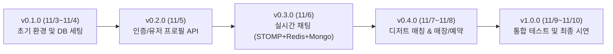

# 🍰 디저팅(Desserting) 백엔드 버전 전략 및 협업 가이드

> **단디톤(Dandi-thon 2026) 백엔드 개발 및 프론트엔드 연동을 위한 버전 표준화 문서**  
> 대상 기간: 2026.11.03 ~ 2026.11.10 (약 1주일 집중 해커톤)

---

## 1. 버전 선정 핵심 원칙 (협업 관점)

1. **안정성 및 호환성 최우선**: 실험적인 최신 비-LTS 버전 대신, 라이브러리 및 플러그인(Lombok, Gradle, SpringDoc 등) 충돌이 없는 검증된 버전을 사용합니다.
2. **로컬 환경 격차 최소화**: 팀원 간 OS(macOS, Windows, Linux) 및 로컬 설치 환경 차이로 인한 빌드 실패를 원천 차단합니다.
   - Gradle Wrapper(`gradlew`) 필수 사용
   - Gradle Java Toolchain을 통한 JDK 버전 강제
   - Docker Compose를 통한 데이터베이스 버전 고정
3. **프론트엔드 연동 인터페이스 안정성**: 
   - 프론트엔드 기술 스택(`openapi-typescript`, `@stomp/stompjs`, `Axios`)과의 스펙 일치 보장
   - URI 버저닝(`/api/v1`) 적용

---

## 2. 권장 기술 스택 및 버전 매트릭스

| 분류 | 권장 기술 / 런타임 | 권장 버전 | 선정 이유 및 협업 유의점 |
| :--- | :--- | :--- | :--- |
| **Language** | **Java** | **21 (LTS)** | • Virtual Threads(Project Loom) 정식 지원 LTS 버전<br>• 최신 Java 25 등 비-LTS는 Lombok/Spring 플러그인 충돌 가능성 높음<br>• Gradle Toolchain으로 21 고정 |
| **Framework** | **Spring Boot** | **3.3.5** | • Java 21 및 Virtual Thread(`spring.threads.virtual.enabled=true`) 완벽 지원<br>• Spring Data JPA/MongoDB/Redis 3개 DB 멀티 데이터소스 호환 안정성 검증<br>• Spring Security 6.3+ 적용 |
| **Build Tool** | **Gradle** | **8.8 ~ 8.10.2** | • Gradle Wrapper(`gradlew`)로 팀원 로컬 Gradle 설치 없이 일관된 빌드<br>• Java 21 공식 지원 빌드 도구 |
| **API Docs** | **SpringDoc OpenAPI** | **2.6.0** | • 프론트엔드의 `openapi-typescript`와 연동하여 Swagger 스펙 기반 TypeScript 타입 자동 생성 지원 |
| **RDB** | **PostgreSQL** | **16-alpine** (Docker) | • 회원, 프로필, 매칭 정보 영구 저장<br>• `latest` 태그 금지, `16-alpine` 경량 이미지로 통일 |
| **NoSQL** | **MongoDB** | **7.0** (Docker) | • 실시간 채팅 메시지 고속 적재 및 페이징 조회<br>• `mongo:7.0` 공식 이미지 고정 |
| **In-Memory** | **Redis** | **7.2-alpine** (Docker) | • STOMP 실시간 Pub/Sub 브로드캐스팅 및 접속 상태(Presence) 캐싱<br>• `redis:7.2-alpine` 고정 |
| **Security & Auth** | **Spring Security + JJWT**| **JJWT 0.12.6** | • JWT Access/Refresh 토큰 기반 Stateless 인증<br>• 최신 JJWT API 표준 문법 적용 |
| **Cloud Storage** | **AWS S3 SDK** | **AWS Java SDK v2 (2.25.x)** | • Presigned URL 발급을 통한 프로필/채팅 미디어 직접 업로드 처리 |

---

## 3. 로컬 협업 환경 통일 가이드

### 3.1. Java Toolchain 설정 (`build.gradle`)
팀원마다 로컬에 설치된 Java 버전이 달라도(예: Java 17, 21, 25 등), Gradle이 자동으로 Java 21을 감지/다운로드하여 일관되게 컴파일하도록 설정합니다.

```groovy
java {
    toolchain {
        languageVersion = JavaLanguageVersion.of(21)
    }
}

tasks.withType(JavaCompile).configureEach {
    options.encoding = 'UTF-8'
}
```

### 3.2. Virtual Threads 활성화 (`application.yml`)
Spring Boot 3.2+부터 지원되는 옵션으로, 채팅 웹소켓 및 비동기 I/O 처리를 최적화합니다.

```yaml
spring:
  threads:
    virtual:
      enabled: true
```

### 3.3. Docker Compose 버전 고정 (`docker-compose.yml`)
로컬 개발 시 팀원 모두 동일한 DB 엔진 버전을 사용하도록 태그를 고정합니다.

```yaml
version: '3.8'

services:
  postgres:
    image: postgres:16-alpine
    container_name: desserting-postgres
    ports:
      - "5432:5432"
    environment:
      POSTGRES_DB: desserting
      POSTGRES_USER: desserting_user
      POSTGRES_PASSWORD: desserting_password
    volumes:
      - postgres_data:/var/lib/postgresql/data

  mongodb:
    image: mongo:7.0
    container_name: desserting-mongodb
    ports:
      - "27017:27017"
    environment:
      MONGO_INITDB_ROOT_USERNAME: desserting_mongo
      MONGO_INITDB_ROOT_PASSWORD: mongo_password
    volumes:
      - mongo_data:/data/db

  redis:
    image: redis:7.2-alpine
    container_name: desserting-redis
    ports:
      - "6379:6379"
    volumes:
      - redis_data:/data

volumes:
  postgres_data:
  mongo_data:
  redis_data:
```

---

## 4. API 버전 관리 전략 (API Versioning)

해커톤 기간 동안 프론트엔드와 백엔드의 잦은 수정 및 배포가 발생하므로, 단순하고 명확한 **URI 버저닝**을 채택합니다.

### 4.1. REST API URI 규칙
- 기본 접두사: `/api/v1`
  - 예: `POST /api/v1/auth/login`
  - 예: `GET /api/v1/users/me`
  - 예: `GET /api/v1/matches/recommendations`
  - 예: `GET /api/v1/chat/rooms`

### 4.2. 실시간 WebSocket (STOMP) 엔드포인트 규칙
- Handshake 연결: `/ws`
- Application Destination Prefix (발행): `/pub`
- Simple Broker Prefix (구독): `/sub`
  - 예: 방 구독 `/sub/chat/room/{roomId}`
  - 예: 메시지 발행 `/pub/chat/message`

### 4.3. 프론트엔드 협업 동기화 규칙
1. 백엔드에서 API 작성 시 `@Operation`, `@ApiResponse` 어노테이션으로 Swagger 명세 작성
2. 로컬 실행 시 `http://localhost:8080/v3/api-docs` 제공
3. 프론트엔드는 `openapi-typescript`를 실행하여 백엔드 DTO 타입 자동 생성:
   ```bash
   npx openapi-typescript http://localhost:8080/v3/api-docs -o src/types/api.d.ts
   ```
4. 배포 시 Vercel(프론트엔드)과 ngrok(백엔드) 간 CORS 허용:
   - ngrok 무료 도메인 경고 우회 헤더(`ngrok-skip-browser-warning: true`) 허용

---

## 5. 해커톤 마일스톤 기반 릴리즈 버저닝 (SemVer)

마감일(11/10)까지 7일간의 점진적 릴리즈 계획:



- **v0.1.0** (Day 1~2): Spring Boot 프로젝트 셋업, Docker Compose 3종 DB 구동, 기본 헬스체크 및 Swagger 연동
- **v0.2.0** (Day 3): JWT 기반 로그인/회원가입, 유저 프로필 및 선호 디저트 등록 API
- **v0.3.0** (Day 4): 프론트엔드 최우선 요청 사항인 **실시간 채팅 시스템 (WebSocket/STOMP, MongoDB 페이징, Redis 브로드캐스팅)** 완성
- **v0.4.0** (Day 5~6): 사용자 매칭 알고리즘, 테마/매장 기반 매칭, 카페 정보 및 예약 API
- **v1.0.0-RC / v1.0.0** (Day 7~8): Vercel + ngrok 연동 최종 점검, 발표 시연 시나리오 검증, 배포 완료

---

## 6. Git 협업 규칙

### 6.1. 브랜치 전략 (Simplified GitHub Flow)
- `main`: 시연 및 최종 제출용 안정 버전 (직접 push 금지, PR 필수)
- `develop`: 개발 통합 브랜치
- `feat/{기능명}`: 단위 기능 개발 브랜치 (예: `feat/chat-stomp`, `feat/auth-jwt`)
- `fix/{버그명}`: 버그 수정 브랜치

### 6.2. 커밋 메시지 컨벤션
- `feat:` 새로운 기능 추가
- `fix:` 버그 수정
- `docs:` 문서 수정
- `refactor:` 코드 리팩토링 (기능 변경 없음)
- `test:` 테스트 코드 작성
- `chore:` 빌드 설정, 의존성 패키지 관리, 환경 설정 등

---

## 7. 다음 단계 (초기 프로젝트 구성 제안)

백엔드 레포지토리에 아직 빌드 파일이 없으므로, 다음 단계로 아래 작업을 진행할 수 있습니다:
1. `build.gradle` (Spring Boot 3.3.5, Java 21, 의존성 일체) 및 `gradlew` 래퍼 생성
2. `docker-compose.yml` (PostgreSQL 16, MongoDB 7.0, Redis 7.2) 구성
3. 기본 패키지 구조 및 Swagger UI 설정 추가
