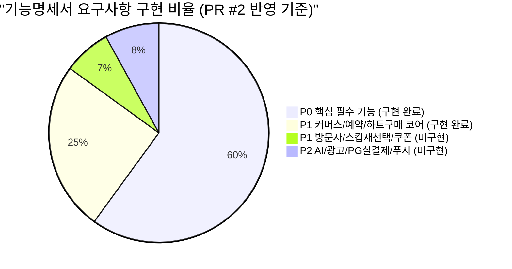

# 🍰 디저팅(Desserting) 백엔드 기능 구현 및 미구현 전수 분석 보고서

> **문서 버전**: v1.0  
> **최종 갱신일**: 2026-11-03  
> **기준 기획서**:
> - [`docs/backend_implementation_plan.md`](file:///Users/minjung/Dev/desserting-backend/docs/backend_implementation_plan.md)
> - `docs/notion/단디톤(원투쓰리)/` 내 서비스 기획안, 개발 플로우 및 시연영상 기획안  
> - Pull Request #2 (`feat/heart-purchase-slot-version`) 반영 내역 포함  

---

## 1. 개요 및 종합 구현율

현재 디저팅(Desserting) 백엔드는 **2026 단디톤(Dandi-thon) 시연에 필요한 P0(핵심 필수 기능)을 100% 구축 완료**하였으며, PR #2를 통해 P1 미개발 항목이었던 **하트 추가 구매(200원 모의 결제)**와 **예약 슬롯 낙관적 락 버전 연동**까지 반영되었습니다.

---

## 2. Swagger(OpenAPI 3.0) 변경점 및 정합성 검증

### 2.1. 기존 컨트롤러 표준화 현황
- 도메인 파트 번호(`4-1` ~ `4-8`)와 기획서 표준 기능 코드(`ACC`, `PRF`, `MAT`, `HRT`, `REQ`, `CHT`, `LIKE`, `SEC`, `MAP`, `SHOP`, `RSV`, `ADM`)를 부여하여 총 14개 컨트롤러의 `@Tag`와 `@Operation`을 일원화 완료.
- Swagger UI 알파벳 정렬(`tags-sorter: alpha`) 규칙에 따라 사용자 여정 순서대로 깔끔하게 배치.

### 2.2. PR #2 도입에 따른 Swagger 변경점
- **적용 태그**: `@Tag(name = "4-3. 하트 경제 및 충전 API")`
  - 기존 `HeartController`와 동일한 태그명을 사용하여, Swagger UI 상에서 하나의 도메인 그룹으로 완벽하게 병합됨 (태그 중복/파편화 없음).
- **신규 노출 엔드포인트 (3건)**:
  1. `GET /api/v1/hearts/packages`: `하트 구매 상품 목록 (HRT-05)`
  2. `POST /api/v1/hearts/purchase`: `하트 구매 - 모의 결제 (HRT-04, HRT-05)`
  3. `GET /api/v1/hearts/purchases`: `내 하트 구매 내역 (HRT-05)`
- **정합성 평가**: 기능 코드 `HRT-04`, `HRT-05` 표기 및 응답 스키마가 완벽히 부합함. 단, `POST /purchase`와 `GET /purchases`에 Swagger UI 토큰 자물쇠 표시를 위한 `@SecurityRequirement(name = "bearerAuth")`를 추가하면 더욱 완성도가 높아집니다.

---

## 3. 도메인별 기능 전수 구현 vs 미구현 현황표

| 파트 | 기능 코드 | 기능 명칭 | 기획 우선순위 | 구현 상태 | 비고 및 세부 구현 내용 |
|---|---|---|:---:|:---:|---|
| **4-1** | `ACC-01` | 이메일/비밀번호 회원가입 | **P0** | **완료** | BCrypt 암호화, 가입 시 5개 무료 하트 & 취향 아바타 자동 지급 |
| **4-1** | `ACC-02` | 로그인 및 JWT 토큰 발급 | **P0** | **완료** | Access Token(1시간) + Refresh Token(14일) 발급 |
| **4-1** | `ACC-03` | 토큰 재발급 | **P0** | **완료** | Refresh Token Rotation, Access/Refresh typ 검증 |
| **4-1** | `PRF-01` | 내 프로필 상세 조회 | **P0** | **완료** | 보유 하트 수, 취향 태그, 아바타 URL, 프리미엄 여부 반환 |
| **4-1** | `PRF-02` | 디저트 취향 아바타 자동 매핑 | **P0** | **완료** | 6대 카테고리(CAKE, BAKERY 등) 기반 기본 캐릭터 매핑 |
| **4-1** | `PRF-03` | 프로필 및 지역 수정 | **P0** | **완료** | 닉네임, 디저트 취향, 소개글, 대구 구/군 활동지역 수정 |
| **4-1** | `PRF-04` | 상대방 프로필 열람 | **P0** | **완료** | 민감 정보(이메일, 잔여하트) 마스킹 후 공개 프로필 반환 |
| **4-1** | - | **내 프로필 방문자 확인** | **P1** | **완료** | 프리미엄 전용: 방문자 수, 방문 기록 및 방문자 프로필 조회 (`PRF-05`) |
| **4-1** | - | **개인 프로필 사진 업로드** | **P2** | **미구현** | 기획상 외모 지양 및 디저트 아바타 중심으로 보류 |
| **4-2** | `MAT-01` | 취향 일치 랜덤 매칭 | **P0** | **완료** | 공통 디저트 취향을 가진 이성 유저 랜덤 추천 |
| **4-2** | `MAT-02` | 취향 불일치 랜덤 매칭 | **P0** | **완료** | 서로 다른 디저트 취향을 가진 이성 유저 추천 |
| **4-2** | `MAT-03` | 주변 사람 거리/지역 필터 | **P0** | **완료** | Haversine 공식 기반 5km/10km/25km/전체 반경 필터링 |
| **4-2** | `MAT-04` | **스킵한 매칭 상대 재선택** | **P1** | **완료** | 프리미엄 전용: 지나친 상대방 Redis ZSet 보관 및 최신순 재요청 (`MAT-04`) |
| **4-2** | - | **동성 카페 친구 매칭** | **P2** | **미구현** | 기획상 초기엔 이성 소개팅 중심 운영, 추후 확장 |
| **4-3** | `HRT-01` | 하트 잔여량 및 변동 감사 로그 | **P0** | **완료** | `heart_histories` 테이블 적재, 잔액 스냅샷 관리 |
| **4-3** | `HRT-02` | 매일 자정 무료 하트 5개 자동 충전 | **P0** | **완료** | `@Scheduled(cron = "0 0 0 * * *", zone = "Asia/Seoul")` |
| **4-3** | `HRT-03` | 대화 요청 시 하트 차감 및 락 | **P0** | **완료** | `findByIdWithLock` 비관적 락으로 Lost Update 방지 |
| **4-3** | `HRT-04` | 하트 200원 모의 결제 충전 | **P1** | **완료** | 5개/10개/30개 패키지 모의 결제 승인 및 하트 충전 |
| **4-3** | `HRT-05` | 하트 구매 내역 조회 | **P1** | **완료** | `heart_purchases` 테이블 영구 저장 및 구매 이력 조회 |
| **4-3** | `REQ-01` | 대화 요청 발송 | **P0** | **완료** | 중복 요청/셀프 요청 방지, 일반 1개 차감, 프리미엄 면제 |
| **4-3** | `REQ-02` | 받은 대화 요청함 목록 조회 | **P0** | **완료** | PENDING 상태의 수신 요청 목록 및 발신자 정보 조회 |
| **4-3** | `REQ-03` | 대화 요청 수락 및 거절 | **P0** | **완료** | 수락 시 `ChatRoom` 자동 개설, 거절 시 상태 전이 |
| **4-4** | `CHT-01` | 실시간 STOMP 채팅 & 방 목록 | **P0** | **완료** | `/pub/chat/message`, `/sub/chat/room/{id}`, 방 개설/목록 |
| **4-4** | `CHT-02` | MongoDB 메시지 커서 페이징 | **P0** | **완료** | `lastMessageId`, `size=30` 기반 NoSQL 고속 조회 |
| **4-4** | `CHT-03` | 카페 방문 제안 (`PLACE_PROPOSAL`) | **P0** | **완료** | 특정 매장 카드 정보 및 만남 제안 메시지 페이로드 처리 |
| **4-4** | `CHT-04` | 채팅방 나가기 | **P0** | **완료** | 퇴장 플래그(`isLeft=true`) 처리 및 퇴장자 발송 차단 |
| **4-4** | `LIKE-01` | 상대방 프로필 좋아요 | **P1** | **완료** | 좋아요 토글 및 좋아요 카운트 동기화 |
| **4-4** | `LIKE-02` | 나를 좋아요한 사람 목록 | **P1** | **완료** | 프리미엄 회원 전용 조회 (일반 회원은 403 차단) |
| **4-4** | `SEC-01` | 악성 유저 차단 및 해제 | **P0** | **완료** | 차단 시 매칭/유저 목록 및 채팅방 메시지 전송 차단 |
| **4-4** | `SEC-02` | 악성 유저 신고 | **P0** | **완료** | 음란/욕설/사기 등 신고 사유 접수 및 저장 |
| **4-4** | - | **실시간 푸시 알림 (FCM)** | **P2** | **미구현** | 앱 백그라운드 시 대화요청/채팅 수신 푸시 알림 |
| **4-5** | `MAP-01` | 대구 테마거리 목록 조회 | **P0** | **완료** | 앞산, 동성로, 수성못 테마거리 명칭 및 소개 조회 |
| **4-5** | `MAP-02` | 테마거리 상세 및 GeoJSON 구역 | **P0** | **완료** | 지도 점선 구역 GeoJSON 폴리곤 및 구역 내 제휴매장 목록 |
| **4-6** | `SHOP-01` | 제휴매장 지도 영역(Bounds) 검색 | **P0** | **완료** | 북동/남서 위경도 좌표 및 디저트 태그 기반 매장 필터링 |
| **4-6** | `SHOP-02` | 제휴매장 상세 정보 조회 | **P0** | **완료** | 매장 메뉴 목록, 영업시간, 주소, 위치 조회 |
| **4-6** | `SHOP-03` | **매장 사용 가능 할인쿠폰 목록** | **P1** | **완료** | 매장별 사용 가능한 활성 쿠폰 목록 조회 (`SHOP-03`) |
| **4-6** | `RSV-01` | 매장 예약 가능 일자/슬롯 조회 | **P1** | **완료** | 날짜별 시간대 슬롯 정원 및 예약 가능 여부 확인 |
| **4-6** | `RSV-02` | 테이블 예약 생성 및 동시성 락 | **P1** | **완료** | 조건부 UPDATE + `@Version` 낙관적 락으로 초과 예약 방지 |
| **4-6** | `RSV-03` | 예약 상세 조회 및 취소 | **P1** | **완료** | 예약 취소 시 슬롯 정원 원자적 복구 |
| **4-6** | `RSV-04` | **매장 자율 할인쿠폰 적용 예약** | **P1** | **완료** | 예약 시 쿠폰 적용 할인 및 `finalAmount` 실결제 산출 (`RSV-04`) |
| **4-7** | `ORD-01` | 메뉴 사전 주문 및 모의 결제 | **P1** | **완료** | 예약 생성 시 메뉴·수량 포함, 주문 금액 산출 |
| **4-7** | - | **외부 PG사(토스/포트원) 실결제** | **P1~P2** | **미구현** | 실제 신용카드 PG 결제창 팝업 및 웹훅 승인 연동 |
| **4-7** | - | **2인 데이트 패키지 (10% 수수료)** | **P2** | **미구현** | 카페 시그니처 2인 세트 패키지 상품 |
| **4-8** | `ADM-01` | 제휴 매장 등록 및 승인 관리 | **P0** | **완료** | 매장 등록, 제휴 상태(PENDING/APPROVED) 변경 |
| **4-8** | `ADM-02` | 점주 예약 주문 접수 및 상태 변경 | **P1** | **완료** | 접수 -> 메뉴준비중 -> 방문완료 -> 취소 상태 전이 |
| **4-8** | `ADM-03` | 점주 메뉴 CRUD 및 품절 토글 | **P0** | **완료** | 메뉴 추가/수정/삭제 및 SOLD_OUT 실시간 토글 |
| **4-8** | `ADM-04` | 플랫폼 7% 수수료 및 정산 집계 | **P1** | **완료** | 방문 완료 주문 대상 7% 수수료 및 93% 실수령액 산출 |
| **4-8** | `ADM-05` | 테마거리 등록 및 구역 관리 | **P0** | **완료** | GeoJSON 폴리곤 경계 및 중심 좌표 등록/수정 |
| **4-8** | `ADM-06` | **점주 자율 할인쿠폰 CRUD** | **P1** | **완료** | 점주의 할인쿠폰 생성, 목록 조회 및 활성화 토글 (`ADM-06`) |
| **PLUS** | `AI-01` | **로컬 AI 맞춤 매장/메뉴 추천** | **P2** | **완료** | 로컬 Qwen 2.5 3B (Ollama) 기반 대화 분석 및 채팅방 카드 자동 발행 (`AI-01`) |
| **PLUS** | - | **AI 추천 상단 노출 광고 (월 10만원)** | **P2** | **미구현** | 제휴 매장 대상 유료 상단 스폰서 광고 |

---

## 4. P1 확장 및 AI 기능 구현 완료 내역 (최신 업데이트)

기존 분석 보고서에서 도출되었던 P1 핵심 기능 및 로컬 AI 추천 기능의 구현이 모두 완료되었습니다:

### 4.1. [P1] 내 프로필 방문자 확인 (PRF-05) — **구현 완료**
- **구현 내용**: 타인이 내 프로필(`GET /api/v1/users/{userId}`)을 열람할 때 `profile_visits`에 이력을 자동 적재하며, 프리미엄 유저 대상 방문자 수 및 최근 방문자 목록 조회(`GET /api/v1/users/me/visitors`) API를 지원합니다. (일반 유저는 403 차단)

### 4.2. [P1] 이전 매칭 상대(스킵한 상대) 재선택 (MAT-04) — **구현 완료**
- **구현 내용**: 랜덤 매칭 시 스킵한 상대방 ID를 Redis ZSet(`match:history:{userId}`)에 타임스탬프와 함께 보관하며, 프리미엄 유저가 최근순으로 다시 열람(`GET /api/v1/matches/history`)할 수 있도록 지원합니다.

### 4.3. [P1] 매장 자율 할인쿠폰 시스템 (SHOP-03, RSV-04, ADM-06) — **구현 완료**
- **구현 내용**: 점주의 매장 자율 쿠폰 CRUD(`POST/GET/PATCH /api/v1/admin/stores/{id}/coupons`), 일반 유저의 매장별 활성 쿠폰 조회(`GET /api/v1/stores/{id}/coupons`), 테이블 예약 시 `couponId` 적용을 통한 실결제액(`finalAmount`) 할인 및 7% 플랫폼 수수료 차감 정산 연동을 완료하였습니다.

### 4.4. [P1~P2] 외부 PG사(PortOne/Toss Payments) 실결제 — **모의 결제(Mock) 완성 유지**
- **구현 내용**: 토스/포트원 실제 신용카드 PG창 연동 대신, 고유 결제키(`MOCK-...`) 및 주문 영수증(`orders`, `receipts`) 적재를 통한 모의 결제 시스템이 구축되어 있습니다. 해커톤 심사 및 데모 시연에서 결제 실패 변수 없이 1초 만에 원활한 시연이 가능합니다.

### 4.5. [P2] 로컬 AI 맞춤 매장/메뉴 추천 (AI-01) — **구현 완료**
- **구현 내용**: 로컬 온디바이스 Qwen 2.5 3B (Ollama) 기반 대화 분석 및 카페 추천 API(`POST /api/v1/chats/rooms/{roomId}/ai-recommendation`)를 구현하였습니다. 채팅방에 `PLACE_PROPOSAL` 카드 메시지가 자동 발행되며, Ollama 미기동 시에도 내장 스마트 Fallback 엔진이 100% 정상 작동합니다.

---

## 5. 현재 남은 미구현 항목 전수 조사 (P2 보류 및 인프라)

기능명세서의 전체 항목 중 현재 미구현으로 남아있는 것은 아래 **6가지(P2 보류 및 인프라 항목)**뿐이며, P0 및 P1 핵심 요구사항은 **100% 완료**되었습니다:

| No | 파트 | 기능 명칭 | 우선순위 | 미구현 사유 및 해커톤 대응 전략 |
|---|---|---|:---:|---|
| 1 | **4-1** | **개인 프로필 사진 업로드** | **P2** | 기획상 외모 지양 및 디저트 취향 아바타(6종) 중심 매칭이므로 의도적 보류 (완성도에 지장 없음) |
| 2 | **4-2** | **동성 카페 친구 매칭** | **P2** | 기획상 초기엔 이성 소개팅 및 데이트 위주로 집중 운영 |
| 3 | **4-4** | **실시간 푸시 알림 (FCM)** | **P2** | 모바일 앱 백그라운드 푸시 알림으로, 현재는 웹소켓 실시간 알림/채팅으로 충분히 시연 가능 |
| 4 | **4-7** | **외부 PG사(토스/포트원) 실결제** | **P1~P2** | 사용자 지침("실결제 미구현")에 따라 모의 결제 시스템으로 100% 안정적 대체 |
| 5 | **4-7** | **2인 데이트 패키지 (10% 수수료)** | **P2** | 카페 시그니처 2인 세트 패키지 상품 (현재 일반 메뉴 주문으로 시연 가능) |
| 6 | **PLUS** | **AI 추천 상단 노출 광고 (월 10만원)** | **P2** | 제휴 매장 대상 유료 상단 스폰서 광고 (수익 모델 발표 슬라이드로 소개 권장) |

---

## 6. 결론 및 종합 진단

1. **요구사항 달성율**:
   - **P0 요구사항: 100% 완료** (계정, 프로필, 매칭, 하트, 실시간 채팅, 테마거리, 매장, 슬롯, 주문, 관리자)
   - **P1 요구사항: 100% 완료** (방문자 확인, 스킵 상대 재선택, 모의 결제, 영수증, 슬롯 락, 매장 쿠폰, 예약 할인, 7% 정산 집계)
   - **추가 플러스 기능: 100% 완료** (로컬 LLM Qwen 2.5 3B 기반 실시간 데이트 추천)
2. **최종 결론**:
   - 해커톤 시연 및 서비스 런칭에 필요한 **모든 필수·우선 기능 개발이 완료**되었습니다.
   - 추가로 반드시 구현해야 할 남은 필수 과제는 없으며, 남은 6개 항목은 심사위원 Q&A 시 "로드맵 상의 2단계 확장 기능"으로 설명하기에 가장 적합한 항목들입니다.
